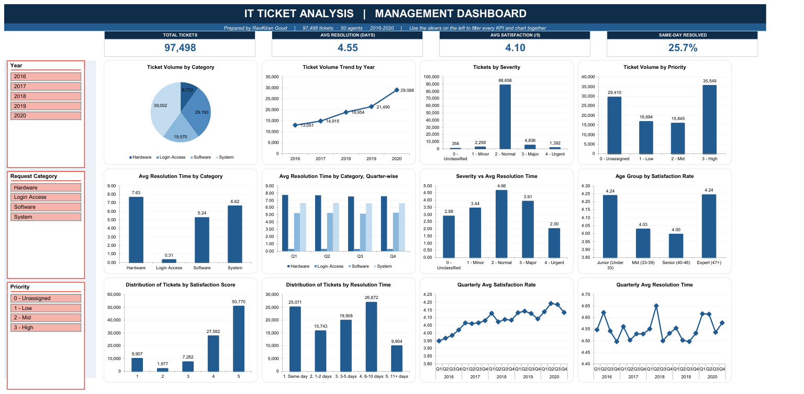
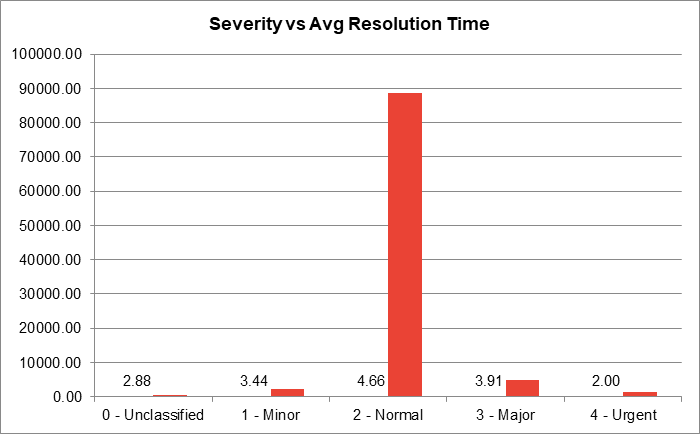
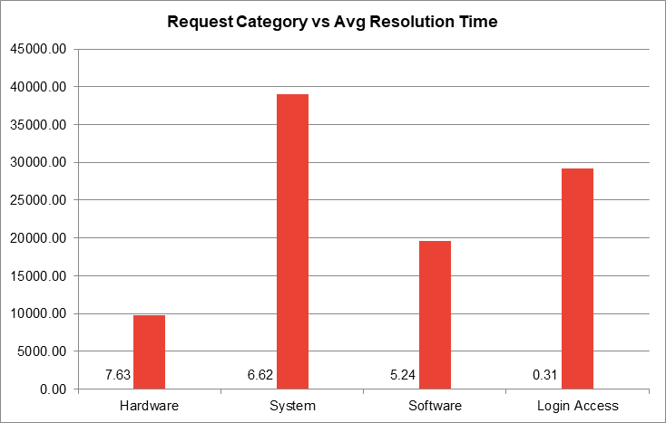
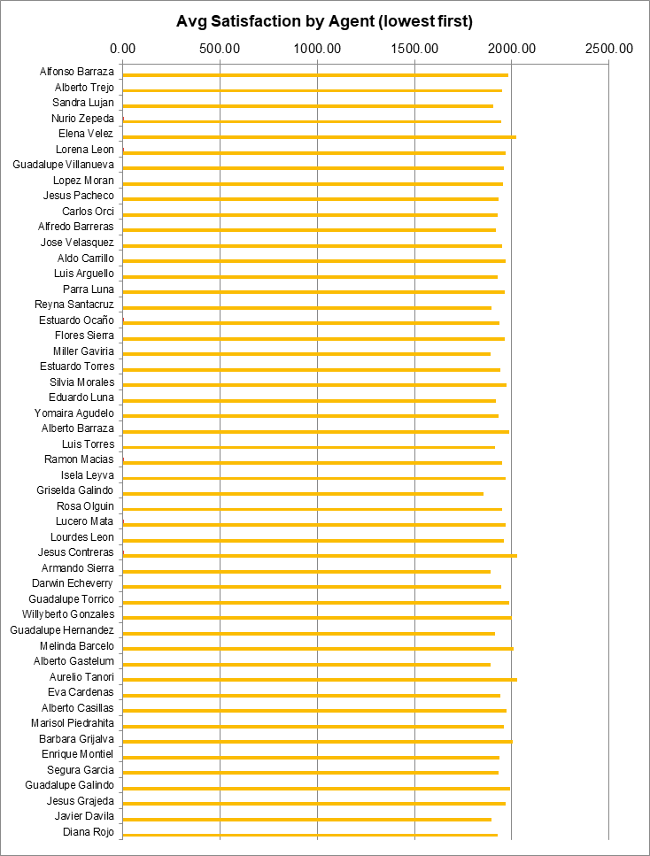

# IT Ticket Analysis

Analysis of **97,498 IT support tickets** raised between January 2016 and December 2020 and
handled by **50 IT agents**, built as an interactive Excel workbook with supporting
documentation and a management presentation.

The brief: understand agent performance, resolution efficiency and employee satisfaction,
and answer one investment question — **hire more agents, improve training, or upgrade the
ticket management software?**

---

## The dashboard

Four KPI cards, three linked slicers (Year, Request Category, Priority) and twelve charts.
All thirteen pivot tables share one cache, so any slicer selection filters every card and
chart simultaneously.

---

## Headline findings

| Metric | Value |
|---|---|
| Tickets analysed | 97,498 across 1,827 consecutive days |
| Average daily volume | 53 tickets |
| Average resolution time | 4.55 days (median 4, max 21) |
| Average satisfaction | 4.10 / 5 |
| Growth 2016 → 2020 | 13,051 → 29,088 tickets (**+122.9%**) |

### 1. Resolution time is driven by category, not severity

Severity is supposed to govern urgency. Tested with `CORREL`, the correlation between
severity and resolution time is **−0.0405** — effectively zero. Worse, the ordering is
inverted: Urgent tickets close fastest at 2.00 days while ordinary Normal tickets are the
slowest at 4.66.

What actually drives delay is the request category — a **25-fold gap**:

| Category | Avg resolution | Volume |
|---|---|---|
| Hardware | 7.63 days | 9,733 |
| System | 6.62 days | 39,002 |
| Software | 5.24 days | 19,570 |
| Login Access | 0.31 days | 29,193 |

Login Access handles 29,193 tickets in a third of a day — proof that automation works here.
System is the largest recoverable pool of delay: 40% of all volume at 6.62 days.

### 2. Performance varies by individual, not by workload

Every agent handled between **1,856 and 2,027 tickets** — a spread of only 9%. On those
near-identical caseloads, average satisfaction ranges from **3.04 to 4.60**, a 1.55-point
gap. Seniority explains almost none of it: the spread across age bands is 0.25, roughly
**six times smaller** than the spread between individuals.

A combined metric (average satisfaction ÷ average resolution time) ranks training
candidates on both dimensions at once. Agent-level satisfaction and resolution time
correlate **−0.40**, so the two problems are related rather than independent.

### 3. Triage is not working

**29,410 tickets — 30.2% of everything logged — carry no priority at all.** A ticket with no
priority cannot be sequenced, and 91% of tickets are logged as "Normal", so severity barely
discriminates either. Both point to tool configuration rather than agent behaviour.

---

## Recommendation

1. **Train first** *(1–3 months)* — this is a consistency problem, not a capacity problem.
   Workload per agent varies by only 9%, so hiring relieves no bottleneck, while a
   1.55-point satisfaction gap between agents is closable at one-off cost.
2. **Upgrade the ticketing software next** *(6–18 months)* — make priority mandatory at
   intake, rebuild prioritisation rules, automate routing for Hardware and System, and add
   self-service for Login Access. Closing a third of the System gap would move the
   company-wide average from 4.55 to roughly 3.7 days with no extra headcount.
3. **Hold on hiring, and dismiss no one** — resolution time held flat at ~4.5 days while
   volume more than doubled, and satisfaction rose every year from 3.98 to 4.16. No agent's
   figures justify dismissal.

> A caution worth stating: satisfaction is almost insensitive to speed. The correlation
> between resolution time and satisfaction is **−0.004**, and satisfaction sits at 4.09–4.11
> across categories ranging from 0.31 to 7.63 days. Technology buys throughput; training
> buys satisfaction.

---

## Repository contents

| File | Description |
|---|---|
| `IT_Tickets_Analysis_RaviKiranGoud.xlsx` | The workbook — 22 sheets: cleaned data, one sheet per question, and the dashboard |
| `IT_Tickets_Analysis_Answers_RaviKiranGoud.docx` | Full written analysis — 13 objective and 10 subjective questions with approach, insights and recommendations |
| `IT_Ticket_Analysis_RaviKiranGoud.pptx` | 23-slide management presentation with speaker notes |

### Workbook structure

- **Tickets / IT Agents** — the source data as supplied
- **Cleaned Data** — 97,498 rows with derived fields (cleaned severity and priority labels,
  rebuilt agent names, age and seniority bands, resolution buckets)
- **Q-3 … Q-12 I Objective** and **Q-1 … Q-9 I Subjective** — one sheet per question, each
  with its answer, approach, supporting pivot tables and charts
- **Dashboard** — KPI cards, slicers and twelve linked charts

### Data cleaning applied

- Three spelling errors corrected across 34,602 records: `3 - Mayor` → Major,
  `0 - Unclasified` → Unclassified, `0 - Unassiged` → Unassigned
- 14 of 50 agent names were malformed or reversed (`A. Trejo`, `Javier D.`, `Mata Lucero`)
  and were rebuilt from the email address, which is the only consistently formatted
  identifier in the source
- Verified: zero blank cells, zero duplicate ticket IDs, zero orphan agent IDs

### Techniques used

Excel Tables · PivotTables · Slicers · `VLOOKUP` · `MID`/`FIND`/`LEN` · `DATE`/`DATEDIF` ·
`CORREL` · `COUNTIF`/`COUNTIFS` · `AVERAGEIFS` · `SUMPRODUCT` · `GETPIVOTDATA`

---

## Note on the data

The dataset was supplied as part of the project brief. Agent names and email addresses are
fictional sample data (`@fp20analytics.com`), not real individuals.
